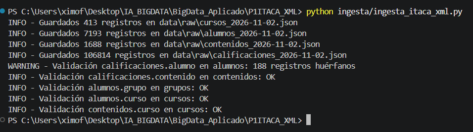
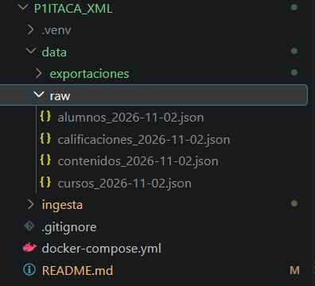

# Proyecto 1 - ITACA (XML)

## Fuentes de datos

**Mecanismo de acceso.** Exportación XML de ITACA. No requiere credenciales: los ficheros se colocan en `data/exportaciones/<curso>/<tabla>.xml` (cursos 2021-22 a 2025-26, centro CIPFP Mislata). Cada XML tiene una cabecera `<centro ... curso="2025" ...>`; ese atributo `curso` es el campo `Anyo` de las tablas.

| Tabla | Fichero | Campos ingestados (además de `Anyo`) |
|---|---|---|
| cursos | `cursos.xml` | codigo, nombre_cas, nombre_val, abreviatura, ensenanza, padre |
| alumnos | `alumnos.xml` | NIA, sexo, nacionalidad, provincia, municipio, ensenanza, curso, grupo, turno, linea, modalidad, repite, estado_matricula, tipo_matricula, fecha_matricula, fecha_ingreso_centro |
| contenidos (módulos) | `contenidos.xml` | codigo, nombre_cas, nombre_val, ensenanza, curso |
| calificaciones | `calificaciones.xml` | evaluacion, alumno, ensenanza, curso, contenido, bloque_contenido, nota_numerica, tipo_nota |

`grupos.xml` se lee solo para validar que cada `alumnos.grupo` existe; no se guarda en `data/raw/`.

**Frecuencia de actualización.** Una exportación por curso académico (anual); la de calificaciones se puede refrescar tras cada evaluación.

## Bitácora de prácticas → Bloque 1

### Proceso

```bash
python -m venv .venv
.venv\Scripts\activate
python ingesta/ingesta_itaca_xml.py
```

El script (solo biblioteca estándar) recorre `data/exportaciones/*/`, parsea las cuatro tablas con `xml.etree.ElementTree`, junta los cinco cursos en una sola tabla (columna `Anyo`) y guarda un JSON por tabla en `data/raw/<tabla>_<fecha>.json`. Los valores vacíos de ITACA (`" "`) se guardan como `null`.

Resultado de la última ejecución: 413 cursos, 7.193 alumnos, 1.688 contenidos y 106.814 calificaciones.

### Anonimización

El NIA se sustituye por `sha256(NIA)[:10]` tanto en `alumnos.NIA` como en `calificaciones.alumno`, con la misma función, así que ambas tablas se pueden seguir cruzando. No se ingestan nombre, apellidos, documento, fecha de nacimiento, teléfonos ni emails. Se verificó que ningún NIA ni documento original aparece en `data/raw/`.

Decisión: sexo, nacionalidad, provincia, municipio y fechas de matrícula se conservan porque el enunciado los pide; son datos de bajo riesgo pero, combinados, podrían reidentificar. Es seudonimización, no anonimización irreversible.

### Verificación de claves

El script valida al final de la ejecución (las claves incluyen `Anyo`):

- calificaciones → contenidos (contenido + curso): OK
- alumnos → grupos: OK
- alumnos → cursos y contenidos → cursos: OK
- calificaciones → alumnos: **188 calificaciones de 9 alumnos del curso 2023 no tienen registro en alumnos.** Probablemente son alumnos con calificación pero sin matrícula en la exportación de ese año. Se deja como advertencia; no se eliminan ni modifican datos en raw.

### Evidencias

Ejecución de `ingesta_itaca_xml.py`:



JSON generados en `data/raw/` (excluidos de Git, solo evidencia local):


