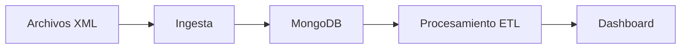

# Proyecto 1: ITACA XML

## Descripción y objetivo

Este proyecto tiene como objetivo preparar un flujo de trabajo para la ingesta y el procesamiento de datos procedentes de archivos XML relacionados con ITACA. El resultado será una estructura organizada para almacenar, transformar y visualizar los datos.

## Arquitectura



## Estructura del repositorio

```text
P1ITACA_XML/
├── .gitignore
├── README.md
├── docker-compose.yml
├── ingesta/
├── etl/
└── dashboard/
```

## Tecnologías

- Python 3.10 o superior.
- Git y GitHub.
- Docker y Docker Compose.
- MongoDB 7.